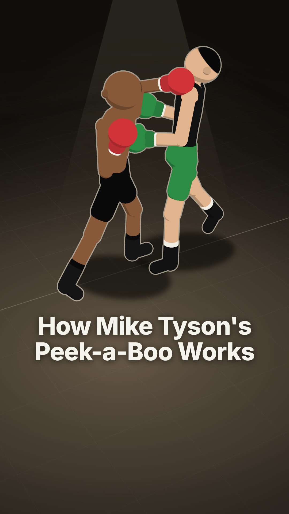
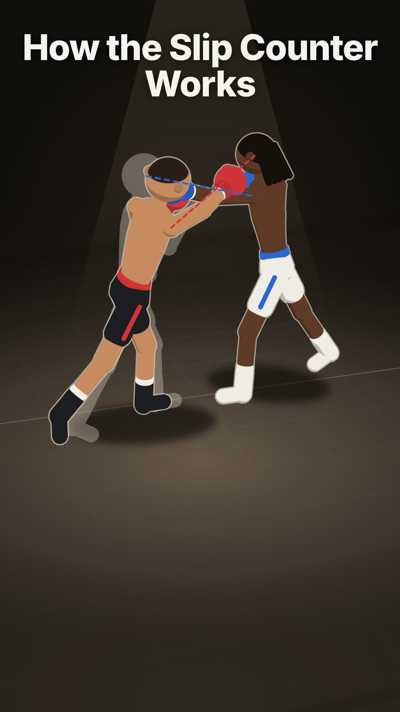
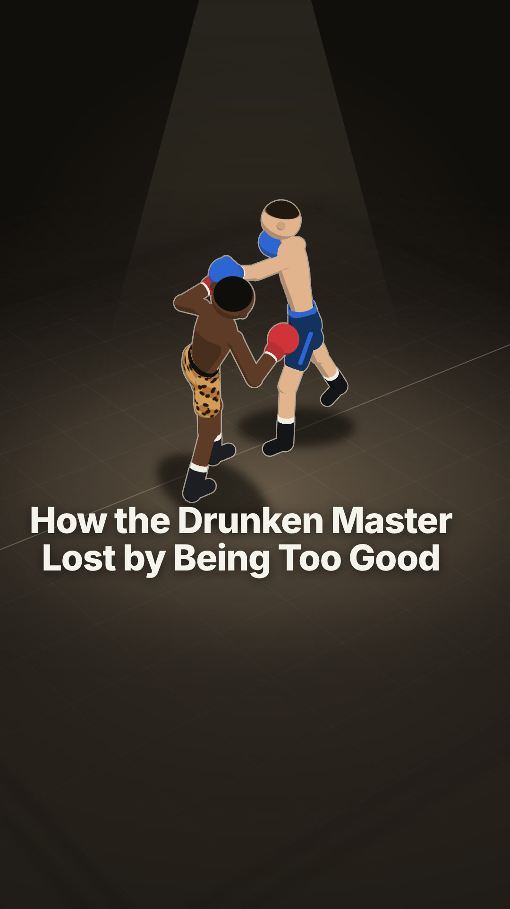
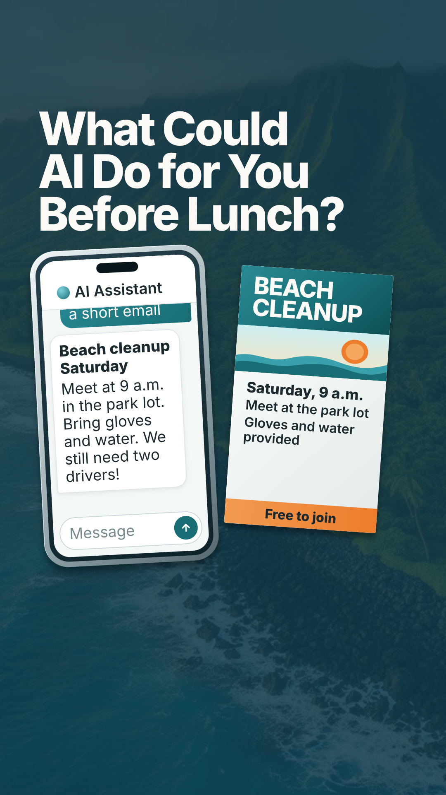

# Kumu

Kumu is a human-in-the-loop agent skill that turns a
topic, article URL, or notes into an informative short video for
TikTok, Reels, and Shorts: how-tos, comparisons, local guides, decision guides,
warnings, explainers, timelines, lists, and what-ifs. It starts from what the
viewer should walk away able to do or understand, picks the form that teaches
it (real screens, a map, an aligned chart, a changing diagram, or a metaphor),
and builds one stage that changes as the explanation unfolds. Videos are narrated with word-highlighted captions, or
visual-only with short on-screen lines. Music and sound effects follow the
style; boxing uses voice and effects without music. You approve the concept and
plan and still previews before composition, then watch a draft in Studio
before approving the final export. Built on
[HyperFrames](https://hyperframes.heygen.com/).

Kumu is an agent-guided workflow, not a standalone video generator. Its
instructions cover the formats above; the styles currently working in
practice are `boxing` and `pupukahi-tech`. The other bundled styles are
samples and should be treated as experimental until demonstrated in finished
videos. Output still needs human review.

## Examples

### Boxing

<table width="100%">
<tr>
<td align="center" width="33%">
<a href="https://github.com/user-attachments/assets/db6ea4a4-6d0d-4eb3-9538-5bfd2f8f3c22">

</a>
<br><strong>How Mike Tyson's Peek-a-Boo Works</strong>
</td>
<td align="center" width="33%">
<a href="https://github.com/user-attachments/assets/9b5299fb-95e1-4541-b000-51918f0abcfb">

</a>
<br><strong>How the Slip Counter Works</strong>
</td>
<td align="center" width="33%">
<a href="https://github.com/user-attachments/assets/c10e44ff-e54a-48a6-a8b0-69fc9c111080">

</a>
<br><strong>How the Drunken Master Lost by Being Too Good</strong>
</td>
</tr>
</table>

### Pūpūkahi Tech

<table width="100%">
<tr>
<td align="center" width="33%">
<a href="https://github.com/user-attachments/assets/4238f820-7218-4ee9-b844-81bcc50996ff">

</a>
<br><strong>What Could AI Do for You Before Lunch?</strong>
</td>
<td align="center" width="33%">
<a href="https://github.com/user-attachments/assets/b4e9f06d-ed29-4e8e-8730-2731cc27c93e">

</a>
<br><strong>Why Blockchain History Is Hard to Rewrite</strong>
</td>
<td align="center" width="33%">
<a href="https://github.com/user-attachments/assets/f4722330-6357-4e18-b38e-c72e831bcbe1">

</a>
<br><strong>Why Stablecoins Stay at $1</strong>
</td>
</tr>
</table>

## Where it runs

Kumu renders on your own computer. Its setup currently targets macOS and
Linux. Native Windows is not supported yet, Windows through WSL2 is untested.

| App | Status |
| --- | --- |
| Claude desktop app (Code tab, local session) | Supported, recommended if you don't use a terminal |
| Claude Code in a terminal | Supported |
| Codex app or Codex CLI | Should work (skill and plugin formats are supported), not yet tested |
| OpenCode | Should work, not yet tested |
| Cloud sessions (claude.ai/code, Codex cloud) | Not supported |
| Chat apps (claude.ai chat, ChatGPT) | Not supported (they cannot render video) |
| Native Windows | Not supported yet |
| Windows through WSL2 | Untested |

## Get started

1. Install [Node.js 22+](https://nodejs.org/), [FFmpeg](https://ffmpeg.org/download.html),
   and [Python 3](https://www.python.org/downloads/). On macOS:
   `brew install node ffmpeg python`.
2. Download this repo (Code → Download ZIP, or `git clone https://github.com/blockchain-in-paradise/kumu.git`).
3. Open the `kumu` folder in your agent:
   - **Claude desktop app:** open the Code tab, choose the `kumu` folder, and
     make sure the session runs locally, not in the cloud.
   - **Claude Code:** `cd kumu && claude`
   - **Codex:** open the `kumu` folder in the Codex app, or run `codex` in it.
4. Ask for a video:

   ```text
   /kumu --topic "Why shortest job first cuts average wait time"
   ```

   In Codex, mention the skill as `$kumu` instead of `/kumu`.

On the first run, Kumu checks your setup and offers to run
`skills/kumu/scripts/setup.sh`. It installs the voice model environment in
`~/.kumu/venv`, the HyperFrames skills, and a headless browser, then runs a
health check. Ignore the BGM (MusicGen) check; Kumu only uses bundled or
supplied music. You can also run the
script yourself at any time; it is safe to repeat.

The working workflow currently uses this repository as the project folder.
Plugin metadata is included, but installation and use from another project
have not been verified. Use the repo-based setup above for now.

## How to use

```text
/kumu --topic "How bubble sort works" --mode visual
/kumu --url https://example.com/article --duration 45
/kumu --topic "7 git commands worth knowing" --ref https://www.tiktok.com/t/XXXX/
/kumu --style boxing --topic "How Lomachenko takes angles" \
  --source https://example.com/lomachenko-profile --source https://example.com/fight-stats
```

- `--mode narrated|visual`: narrated uses a voice and word-highlighted
  captions (30–90 s). Visual has no voice: short on-screen lines and the
  style's audio layers (10–90 s). Without it, Kumu recommends one per concept.
- `--source <url>`: a web page the video is about (an article, profile, or
  stats page). Kumu reads these before searching and uses search only to fill
  gaps. Repeatable.
- `--ref <url>`: a video whose structure you like. Kumu studies its layout and
  pacing; it copies its characters and style only when you ask it to replicate
  the reference, and never reuses its footage or audio. Repeatable.
- `--tone` sets the voice of the writing, such as "clear build-along guide".
- `--duration` sets the target length in seconds, including the closing card.
- `--format vertical|square|landscape` is accepted by the skill. Vertical
  1080×1920 is the default and the current final-render instructions target
  that size; square and landscape exports need their dimensions checked.
- `--style <name>` picks a saved style (see Styles). Without it, Kumu uses
  the bundled `plain` style: neutral, with a payoff ending and no branded CTA.
- `--no-captions`, `--no-music`, `--no-sfx` turn off individual layers.
  `--no-voice` is the same as `--mode visual`.

To pick up a saved run in a new session:

```text
/kumu Resume video-output/<run-directory>/ and continue.
```

## Pipeline

1. **Research.** Kumu researches the topic and saves supported claims, sources,
   and usable visuals to `research.json`, including evidence for whatever
   drives the animation (an algorithm, a simulation, real command output).
2. **Concept.** It names the goal (after watching, the viewer can ___), then
   writes three concepts in at least two different forms, such as a
   walkthrough, comparison, map, decision path, red flags, or metaphor. A style
   with a fixed form, such as boxing's technique breakdown, gets three angles
   within that form instead. Each names the stage, its sources, the value the
   viewer tracks, and the payoff. It recommends one.
3. **Script and plan.** For the recommended concept it writes the narration
   (`SCRIPT.md`) or the on-screen lines, and the stage's states, each tied to
   the words that trigger it, in `video-plan.md`.

   **Checkpoint 1: plan review.** Check the plan and still previews of the
   opening, hero state, and closing alongside a cover preview, then approve,
   pick another concept, or ask for changes. No audio or animation has been
   made yet, so changes here are cheap.

4. **Compose.** It generates the voice and captions when narrated, builds the
   animated stage in HyperFrames, mixes the style's audio layers, and designs
   the cover.

   Before showing you anything, Kumu reviews its own work: it renders a draft
   and measures it (checks, a video audit for edge clipping, flicker, and
   frozen stretches, the style's kit audit or a DOM animation map, and
   loudness). It inspects a contact sheet and flagged frames, fixes defects,
   and repeats for up to three rounds. Any unresolved issues are reported;
   technical checks do not prove editorial quality.

   **Checkpoint 2: Studio review.** Watch the video in the HyperFrames Studio
   preview it opens, and check `thumbnail.jpg`. Approve it or list changes.

5. **Render.** It encodes the final `video.mp4` at 30 fps, checks its metadata
   and representative frames, and promotes accepted reusable assets into the
   style's library when their licenses allow it.

At either checkpoint, reply `Yes` to continue, `No` to stop and keep the files,
or describe what to change. You can also edit the files directly first.

```text
video-output/
  YYYY-MM-DD-HHmmss-topic/
    research.json
    video-plan.md    concepts, stage, states, thumbnail brief, status
    SCRIPT.md        narrated mode only
    composition/     HyperFrames project, assets, review evidence
    video.mp4
    thumbnail.jpg
```

## Styles

A style is the look of a video: background, palette, type, how subjects are
drawn or photographed, motion, captions, and the closing card. Each style is a
folder with `style.md` (its tokens and rules), `index.html` (a working sample
video), `thumbnail/` (a cover sample), `preview.png` (four frames side by
side: thumbnail, empty, elements with caption, and closing), and `assets/`.
Rebuild a preview with `skills/kumu/scripts/style-preview.sh <style-dir>`. Videos start from the style's sample, so every video in
a style looks like it belongs to the same page. `skills/kumu/frame.md` holds
the rules every style follows: layout zones, legibility, honest numbers, and
pacing.

Bundled styles live in `skills/kumu/styles/`. `boxing` and `pupukahi-tech`
are the working styles featured above; `plain`, `motion`, `code-cats`, and
`car-cats` are experimental samples:

- `pupukahi-tech`: navy island ground, white Inter type, teal data,
  gold word highlight, and the @pupukahi_tech closing card.
- `plain` (default): light gray, black type, one orange-red accent, ends on a payoff card.
- `motion`: light UI motion graphics with drifting color fields, white UI
  cards, a cursor, blur-in headlines, and a two-line payoff ending.
- `code-cats`: cartoon cats act out code above a code editor, on switchable
  2D backdrops (green park, cozy room, night rooftop), with typing and meow
  sounds.
- `car-cats`: real car photos in angled panels on a dark carbon racing
  backdrop, a header that swaps to each car's name, and the gato cat meme
  reacting, with garage tool and meow sounds.
- `boxing`: fight night in a spotlit canvas ring. Flat-shaded fighters on a 3D
  rig (red corner vs blue corner) move through smooth camera views, body marks
  and ghosts point at what the words name, and a quiet broadcast lower third
  carries the words, with punch, whoosh, and bell sounds and the George voice.
  It opens mid-fight and closes on a title card. A knockout ending (done right
  the rival drops, then a replay done wrong drops you) is available when the
  prompt asks for one. Ships the rig, poses, and fighter looks in
  `assets/characters/`.

Each style also carries its own sound effects in `assets/sfx/`, listed with
their licenses in `assets/sfx/CREDITS.md`, and a Sound section in `style.md`
that maps events to sounds.

Build your own from reference videos:

```text
$kumu style --ref https://www.tiktok.com/t/XXXX/ --name menu-motion
```

Kumu studies the references, builds three short sample directions (faithful,
with an existing style's identity when you pass `--identity <style>`, and a
variation), and opens a gallery page where you watch them side by side. Pick
one, or mix them, and it saves to `styles/<name>/` in your project. Then:

```text
$kumu --style menu-motion --topic "Why menus stay open when you move diagonally"
```

## Credits

- Original workflow: [BRAG](https://github.com/latent-spaces/brag), MIT
- Music: [ende.app](https://ende.app/en), Happy Beats / Business Moves.
- SFX: [Kenney](https://kenney.nl/)
- Platform icons: [Bootstrap Icons](https://icons.getbootstrap.com/), MIT
- Rendering: [HyperFrames](https://hyperframes.heygen.com/)

### Workflow inspiration

These projects informed the workflow design. Their instructions and code are
not bundled or required at runtime; the skill uses HyperFrames for production.

- [BRAG](https://github.com/latent-spaces/brag): creative orchestration and composition briefs.
- [HVE Video Director](https://github.com/nebrass/hve-video-director): a focused brief for each scene.
- [Writing Style and Tone](https://github.com/creator-futures/social-media-skills/tree/main/skills/writing-style-and-tone): specificity, spoken rhythm, and editing without invented experience.
- [Faceless Shorts Creator](https://github.com/hassancs91/claude-faceless-shorts-creator): explicit narration/visual beats and frame review. This skill keeps those beats in `video-plan.md`.
- [Video TalkCraft](https://github.com/Vincentwei1021/video-talkcraft) and [Video ShotCraft](https://github.com/Vincentwei1021/video-shotcraft): shot planning and motion linked to narration. Their templates, code, and mandatory approval flows are not imported.
