# Kumu

Kumu is a human-in-the-loop agent skill that turns a topic, article URL, or notes into an informative short video for TikTok, Reels, and Shorts. It starts from what the viewer should walk away able to do or understand, picks the form that teaches it, and builds one stage that changes as the explanation unfolds. Videos are narrated with word-highlighted captions, or visual-only with short on-screen lines, and are built on [HyperFrames](https://hyperframes.heygen.com/).

This skill is an agent-guided workflow, not a standalone video generator: you approve the concept and plan, then watch a draft in Studio before the final export. Every bundled style has finished examples below, but output still needs human review.

## Examples
~30-second previews "one-shotted" from a single prompt.

### Boxing

<table width="100%">
<tr>
<td align="center" width="33%">
<a href="https://github.com/user-attachments/assets/42f8e02d-6ed4-4eab-be61-f45acae5715a">
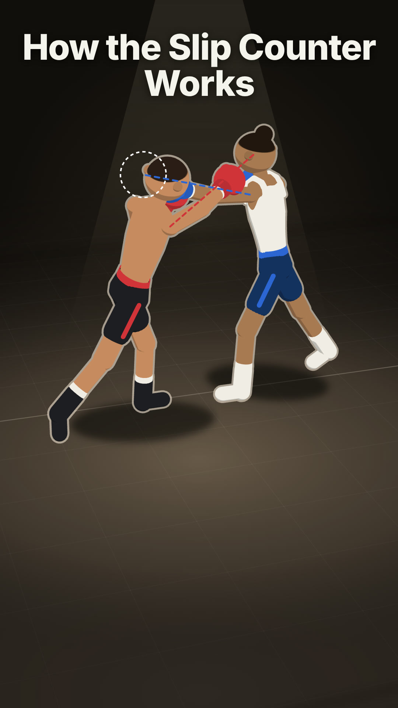
</a>
<br><strong>How the Slip Counter Works</strong>
</td>
<td align="center" width="33%">
<a href="https://github.com/user-attachments/assets/8f649263-39c4-45f7-b509-b0f9553ffad5">
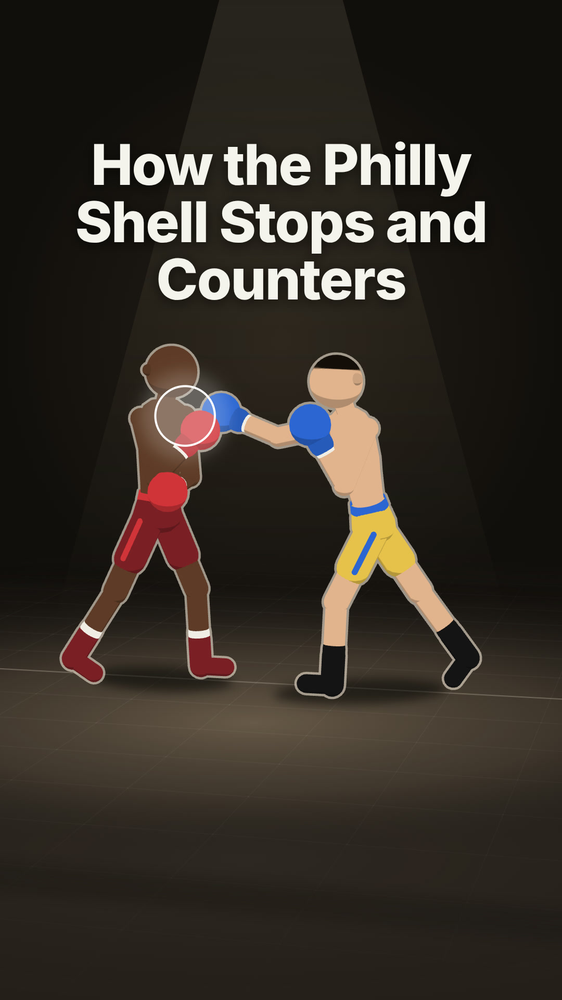
</a>
<br><strong>How Does the Philly Shell Stop a Punch and Set Up a Counter?</strong>
</td>
<td align="center" width="33%">
<a href="https://github.com/user-attachments/assets/77413758-8900-4f04-9985-b19ec71dbd85">
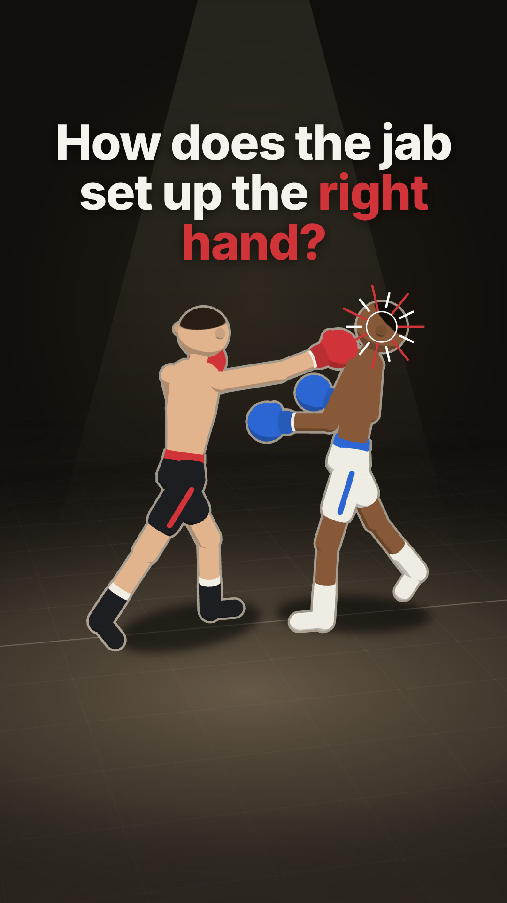
</a>
<br><strong>How Does the Jab Set Up the Right Hand?</strong>
</td>
</tr>
</table>

### Car Cats

<table width="100%">
<tr>
<td align="center" width="33%">
<a href="https://github.com/user-attachments/assets/92d70801-e772-41df-9912-ab8cc3e71a8e">
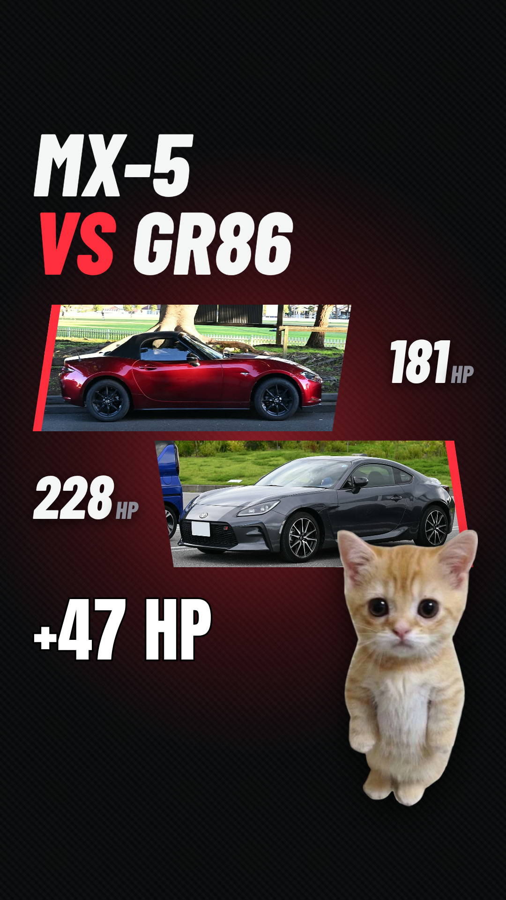
</a>
<br><strong>MX-5 Versus GR86 Horsepower</strong>
</td>
<td align="center" width="33%">
<a href="https://github.com/user-attachments/assets/6ad74c1e-b754-47b9-a167-c441c3d87e59">
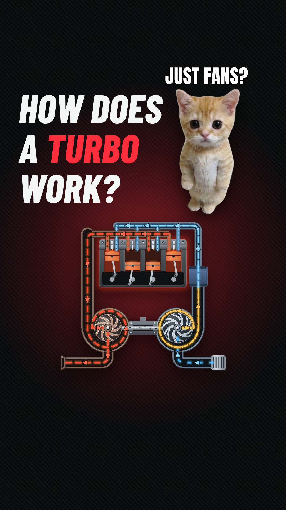
</a>
<br><strong>How Does a Turbo Work?</strong>
</td>
<td align="center" width="33%">
<a href="https://github.com/user-attachments/assets/751265aa-5afa-45d4-9e32-5aa1b7bbe4ba">
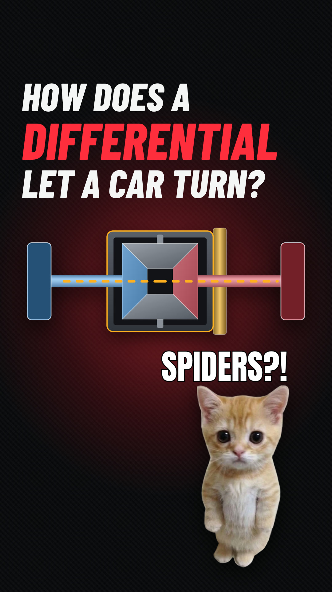
</a>
<br><strong>How Does a Differential Let a Car Turn?</strong>
</td>
</tr>
</table>

### Code Cats

<table width="100%">
<tr>
<td align="center" width="33%">
<a href="https://github.com/user-attachments/assets/fdcb1f7a-8e42-4289-a211-5b6321edf00a">
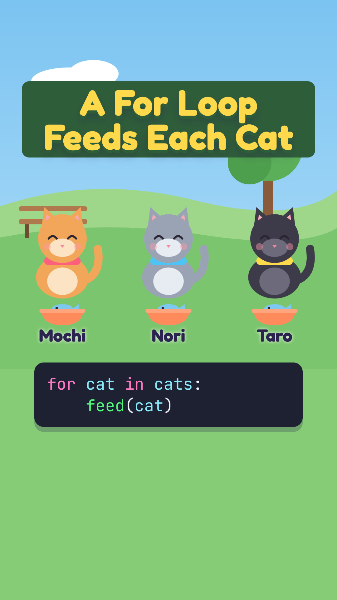
</a>
<br><strong>A For Loop Feeds Each Cat</strong>
</td>
<td align="center" width="33%">
<a href="https://github.com/user-attachments/assets/d2dbc811-3e23-4072-9992-5229130639ad">
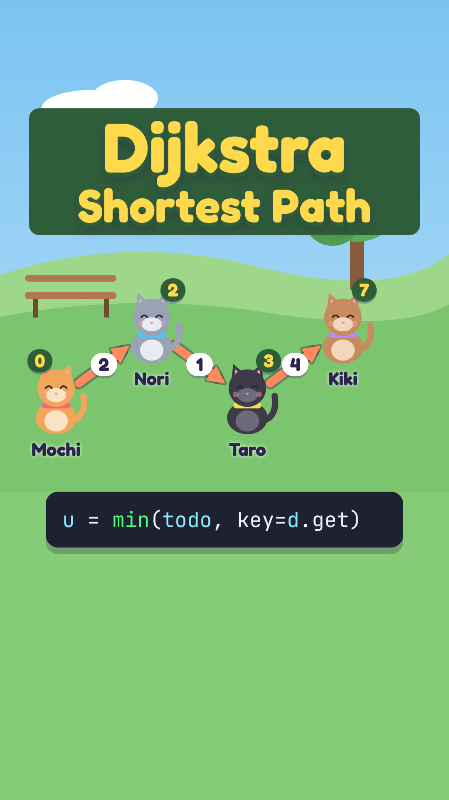
</a>
<br><strong>How Does Dijkstra's Algorithm Find the Shortest Path?</strong>
</td>
<td align="center" width="33%">
<a href="https://github.com/user-attachments/assets/ac8ac662-3c46-42b5-be67-d58611daca8f">
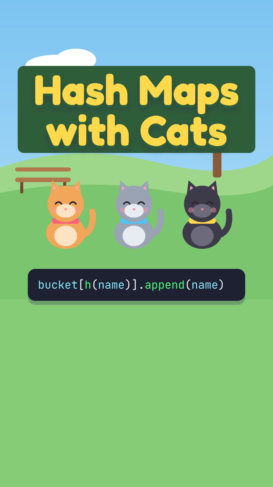
</a>
<br><strong>How Does a Hash Map Find Things Instantly?</strong>
</td>
</tr>
</table>

### Motion

<table width="100%">
<tr>
<td align="center" width="33%">
<a href="https://github.com/user-attachments/assets/ee52ff52-5c1a-4706-a6d2-9a074409ab97">
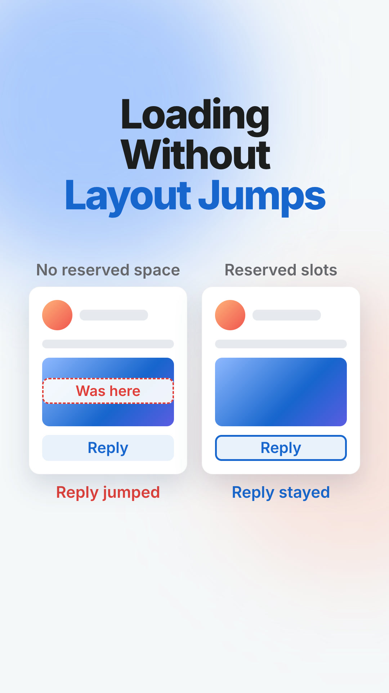
</a>
<br><strong>Loading Without Layout Jumps</strong>
</td>
<td align="center" width="33%">
<a href="https://github.com/user-attachments/assets/6401ac49-5c2e-41c2-9456-a4b8f9668a04">

</a>
<br><strong>Why Does a Button Feel Broken Without Instant Feedback?</strong>
</td>
<td align="center" width="33%">
<a href="https://github.com/user-attachments/assets/7047b24f-a1d1-4237-ba76-5f0a449f4cc1">
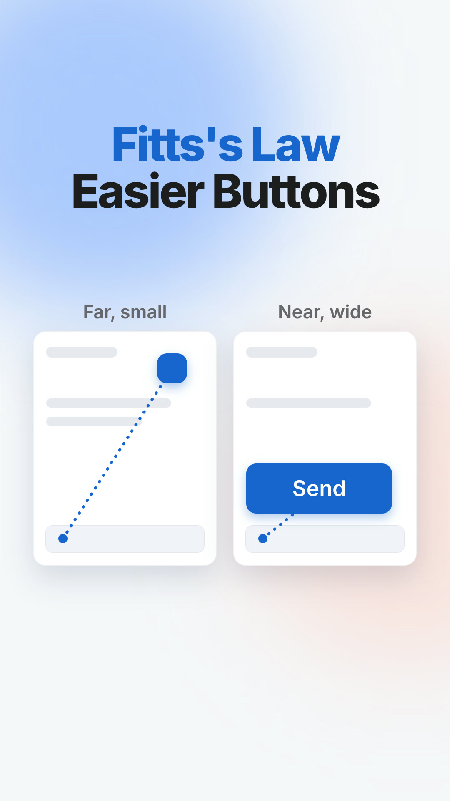
</a>
<br><strong>How Does Fitts's Law Make Buttons Easier to Hit?</strong>
</td>
</tr>
</table>

### Plain

<table width="100%">
<tr>
<td align="center" width="33%">
<a href="https://github.com/user-attachments/assets/c9802665-3cad-474c-9dd2-9d1d9547e0b7">
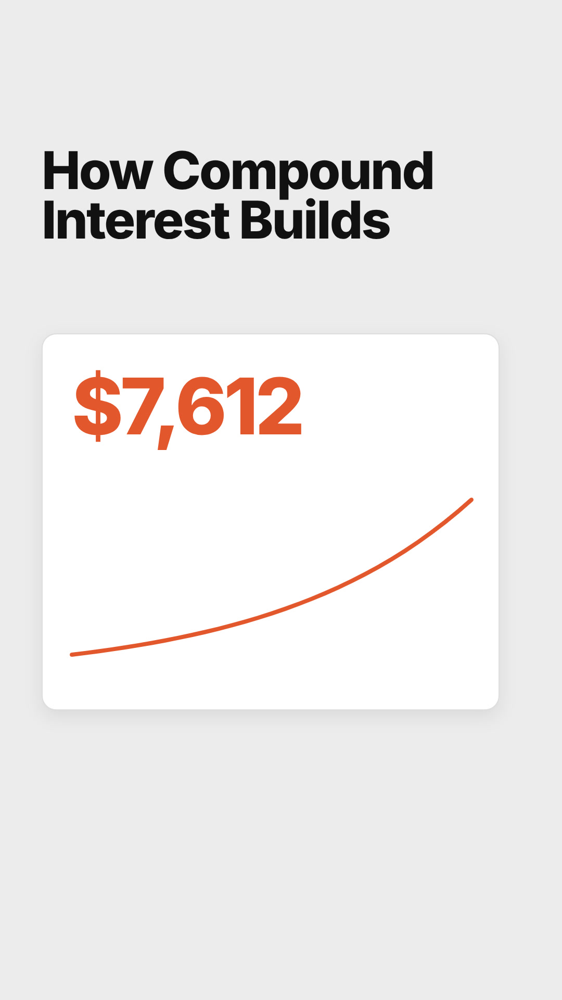
</a>
<br><strong>How Compound Interest Builds</strong>
</td>
<td align="center" width="33%">
<a href="https://github.com/user-attachments/assets/84cd7183-ca7f-4e65-a5fd-0a6dd286b365">
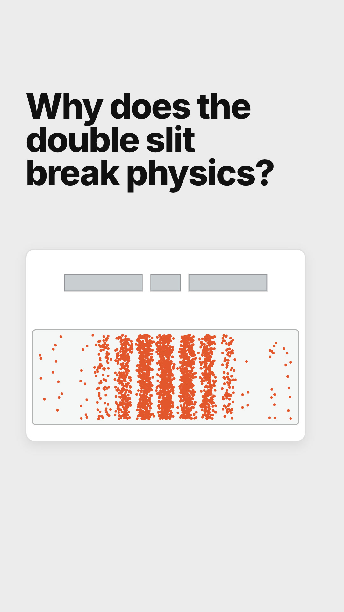
</a>
<br><strong>Why Does the Double-Slit Experiment Break Physics?</strong>
</td>
<td align="center" width="33%">
<a href="https://github.com/user-attachments/assets/c81b5ec7-1f11-443a-9950-fce3f40861d2">
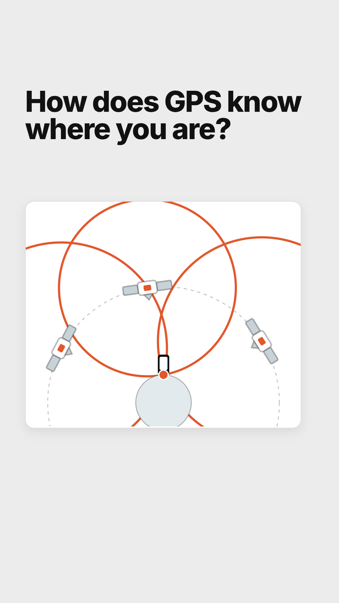
</a>
<br><strong>How Does GPS Know Where You Are?</strong>
</td>
</tr>
</table>

### Pūpūkahi Tech

<table width="100%">
<tr>
<td align="center" width="33%">
<a href="https://github.com/user-attachments/assets/15f54c03-8b0c-4bdf-9c4f-e1abdb756f07">

</a>
<br><strong>How Redemption Supports a Stablecoin</strong>
</td>
<td align="center" width="33%">
<a href="https://github.com/user-attachments/assets/5b39eced-592f-4628-a249-571e5d0f7657">

</a>
<br><strong>3 AI Tools Local Businesses Can Afford</strong>
</td>
<td align="center" width="33%">
<a href="https://github.com/user-attachments/assets/592ab204-a3d5-401b-95b9-8a0765b1a4ee">
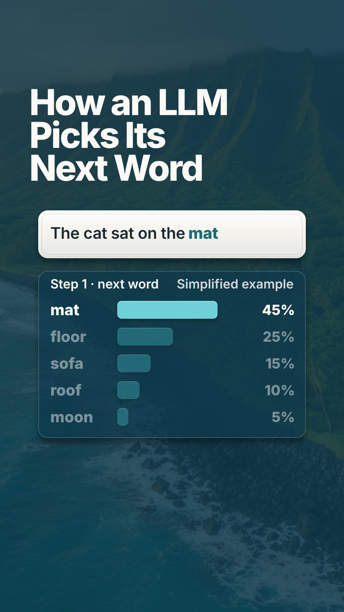
</a>
<br><strong>How Does an LLM Pick Its Next Word?</strong>
</td>
</tr>
</table>

## Where it runs

Kumu renders on your own computer, so it needs an agent that can run local commands. It has been tested with Claude Code, Codex, and ChatGPT. Setup targets macOS and Linux. Windows is untested, and cloud sessions and plain chat apps can't render video.

## Get started

1. Install [Node.js 22+](https://nodejs.org/), [FFmpeg](https://ffmpeg.org/download.html),
   and [Python 3](https://www.python.org/downloads/). On macOS:
   `brew install node ffmpeg python`.
2. Download this repo (Code → Download ZIP, or `git clone https://github.com/blockchain-in-paradise/kumu.git`).
3. Open the `kumu` folder in your agent:
   - **Claude Code:** `cd kumu && claude`
   - **Codex:** open the `kumu` folder in the Codex app, or run `codex` in it.
4. Ask for a video:

   ```text
   /kumu --topic "Why shortest job first cuts average wait time"
   ```

   In Codex, mention the skill as `$kumu` instead of `/kumu`.

On the first run, Kumu checks your setup and offers to run
`skills/kumu/scripts/setup.sh`. It installs the voice model environment in
`~/.kumu/venv`, the HyperFrames skills, and a headless browser, then runs a
health check. Ignore the BGM (MusicGen) check; Kumu only uses bundled or
supplied music. You can also run the
script yourself at any time; it is safe to repeat.

The working workflow currently uses this repository as the project folder.
Plugin metadata is included, but installation and use from another project
have not been verified. Use the repo-based setup above for now.

## How to use

```text
/kumu --topic "How bubble sort works"
/kumu --url https://example.com/article --duration 45
/kumu --topic "7 git commands worth knowing" --ref https://www.tiktok.com/t/XXXX/
/kumu --style boxing --topic "How Lomachenko takes angles" \
  --source https://example.com/lomachenko-profile --source https://example.com/fight-stats
```

Give it a topic (`--topic`), an article (`--url`), or notes. Everything else is optional:

- `--mode narrated|visual`: narrated has a voice with word-highlighted captions
  (30–90 s). Visual has no voice, just short on-screen lines (10–90 s). If you
  skip it, Kumu recommends one.
- `--style <name>`: a saved look (see Styles). Defaults to `plain`.
- `--duration <seconds>`: target length, including the ending.
- `--source <url>`: a page the video is about, like an article, profile, or stats
  page. Kumu reads it first and searches only to fill gaps. Repeatable.
- `--ref <url>`: a video whose structure you like. Kumu studies its layout and
  pacing, but never reuses its footage, audio, or characters. Repeatable.
- `--tone <direction>`: the writing voice, like "clear build-along guide". The
  style always wins over it.
- `--format vertical|square|landscape`: vertical 1080×1920 is the default and
  the only size the final render is tuned for.
- `--no-captions`, `--no-music`, `--no-sfx`: turn off a layer. `--no-voice` is the
  same as `--mode visual`.

To pick up a saved run in a new session:

```text
/kumu Resume video-output/<run-directory>/ and continue.
```

## Pipeline

1. **Research.** Kumu researches the topic and saves supported claims, sources,
   and usable visuals to `research.json`, including evidence for whatever
   drives the animation (an algorithm, a simulation, real command output).
2. **Concept.** It names the goal (after watching, the viewer can ___), then
   writes three concepts in at least two different forms, such as a
   walkthrough, comparison, map, decision path, red flags, or metaphor. A style
   with a fixed form, such as boxing's technique breakdown, gets three angles
   within that form instead. Each names the stage, its sources, the value the
   viewer tracks, and the payoff. It recommends one.
3. **Script and plan.** For the recommended concept it writes the narration
   (`SCRIPT.md`) or the on-screen lines, and states in `video-plan.md`:
   before, action, result, attention handoff, and speech anchors. Reading holds
   are recorded with their purpose and duration.

   **Checkpoint 1: plan review.** Check the plan and still previews of the
   opening, hero state, and closing alongside a cover preview, then approve,
   pick another concept, or ask for changes. No audio or animation has been
   made yet, so changes here are cheap.

4. **Compose.** It generates the voice and captions when narrated, builds the
   animated stage in HyperFrames, mixes the style's audio layers, and designs
   the cover.

   Before showing you anything, Kumu reviews its own work: it renders a draft
   and measures it (checks, a video audit for edge clipping, flicker, and
   frozen stretches, the style's kit audit or a DOM animation map, and
   loudness). It inspects every scene's main result and important motion
   handoffs as well as flagged frames, fixes defects, and repeats for up to
   three rounds. Any unresolved issues are reported;
   technical checks do not prove editorial quality.

   **Checkpoint 2: Studio review.** Watch the video in the HyperFrames Studio
   preview it opens, and check `thumbnail.jpg`. Approve it or list changes.

5. **Render.** It encodes the final `video.mp4` at 30 fps, checks its metadata
   and representative frames, and promotes accepted reusable assets into the
   style's library when their licenses allow it.

Both human checkpoints remain mandatory; there is no autonomous review option.
Self-review improves what you see, and never replaces your approval.

At either checkpoint, reply `Yes` to continue, `No` to stop and keep the files,
or describe what to change. You can also edit the files directly first.

```text
video-output/
  YYYY-MM-DD-HHmmss-topic/
    research.json
    video-plan.md    concepts, stage, states, thumbnail brief, status
    SCRIPT.md        narrated mode only
    composition/     HyperFrames project, assets, review evidence
    video.mp4
    thumbnail.jpg
```

## Styles

A style is the look of a video: background, palette, type, how subjects are
drawn or photographed, motion, captions, and the closing card. Each style is a
folder with `style.md` (its tokens and rules), `index.html` (a working sample
video), `thumbnail/` (a cover sample), `preview.png` (four frames side by
side: thumbnail, empty, elements with caption, and closing), and `assets/`.
Rebuild a preview with `skills/kumu/scripts/style-preview.sh <style-dir>`. Videos start from the style's sample, so every video in
a style looks like it belongs to the same page. `skills/kumu/frame.md` holds
the rules every style follows: layout zones, legibility, honest numbers, and
pacing.

Bundled styles live in `skills/kumu/styles/`, each with finished examples above:

- `boxing`: fight night in a spotlit canvas ring. Flat-shaded fighters on a 3D
  rig (red corner vs blue corner) move through smooth camera views, body marks
  and ghosts point at what the words name, and a quiet broadcast lower third
  carries the words, with punch, whoosh, and bell sounds and the George voice.
  It opens mid-fight and closes on a title card. A knockout ending (done right
  the rival drops, then a replay done wrong drops you) is available when the
  prompt asks for one. Ships the rig, poses, and fighter looks in
  `assets/characters/`.
- `car-cats`: real car photos in angled panels on a dark carbon racing
  backdrop, a header that swaps to each car's name, and the gato cat meme
  reacting, with garage tool and meow sounds.
- `code-cats`: cartoon cats act out code above a code editor, on switchable
  2D backdrops (green park, cozy room, night rooftop), with typing and meow
  sounds.
- `motion`: light UI motion graphics with drifting color fields, white UI
  cards, a cursor, blur-in headlines, and a two-line payoff ending.
- `plain` (default): light gray, black type, one orange-red accent, ends on a payoff card.
- `pupukahi-tech`: navy island ground, white Inter type, teal data,
  gold word highlight, and the @pupukahi_tech closing card.

Each style also carries its own sound effects in `assets/sfx/`, listed with
their licenses in `assets/sfx/CREDITS.md`, and a Sound section in `style.md`
that maps events to sounds.

Build your own from reference videos:

```text
$kumu style --ref https://www.tiktok.com/t/XXXX/ --name menu-motion
```

Kumu studies the references, builds three short sample directions (faithful,
with an existing style's identity when you pass `--identity <style>`, and a
variation), and opens a gallery page where you watch them side by side. Pick
one, or mix them, and it saves to `styles/<name>/` in your project. Then:

```text
$kumu --style menu-motion --topic "Why menus stay open when you move diagonally"
```

## Resources and inspiration

Kumu renders with [HyperFrames](https://hyperframes.heygen.com/) and its
skills (creative, animation, core, CLI, audio, media, and registry). When a
video calls for it, the pipeline also consults these references and records
what it used in `video-plan.md`; they are fetched on demand, not bundled
(see [resource loading](skills/kumu/references/design-resources.md)):

- [IBM animation guidance](https://www.ibm.com/design/language/animation/tips-and-techniques/): attention, rhythm, and sequencing.
- [IBM technical diagrams](https://www.ibm.com/design/language/infographics/technical-diagrams/design/): systems, sequences, and hierarchies.
- [Material choreography](https://m1.material.io/motion/choreography.html): UI interaction and object continuity.

### Workflow inspiration

These projects informed the workflow design. Their instructions and code are
not bundled or required at runtime; the skill uses HyperFrames for production.

- [BRAG](https://github.com/latent-spaces/brag): creative orchestration and composition briefs.
- [HVE Video Director](https://github.com/nebrass/hve-video-director): a focused brief for each scene.
- [Writing Style and Tone](https://github.com/creator-futures/social-media-skills/tree/main/skills/writing-style-and-tone): specificity, spoken rhythm, and editing without invented experience.
- [Faceless Shorts Creator](https://github.com/hassancs91/claude-faceless-shorts-creator): explicit narration/visual beats and frame review. This skill keeps those beats in `video-plan.md`.
- [Video TalkCraft](https://github.com/Vincentwei1021/video-talkcraft) and [Video ShotCraft](https://github.com/Vincentwei1021/video-shotcraft): shot planning and motion linked to narration. Their templates, code, and mandatory approval flows are not imported.
